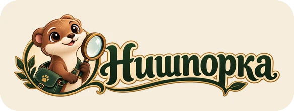
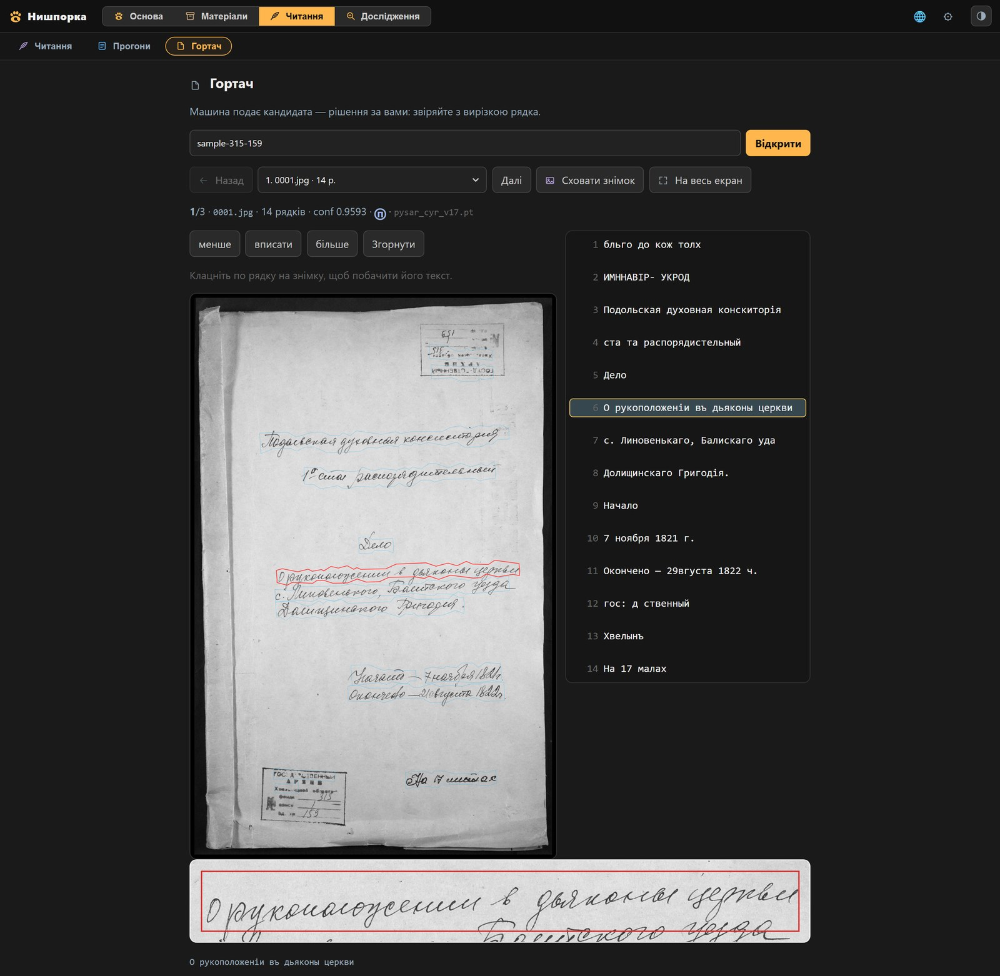
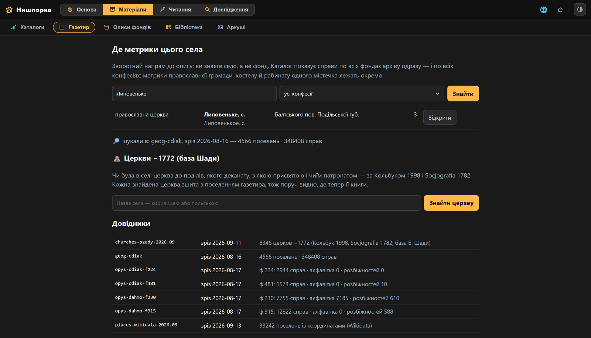
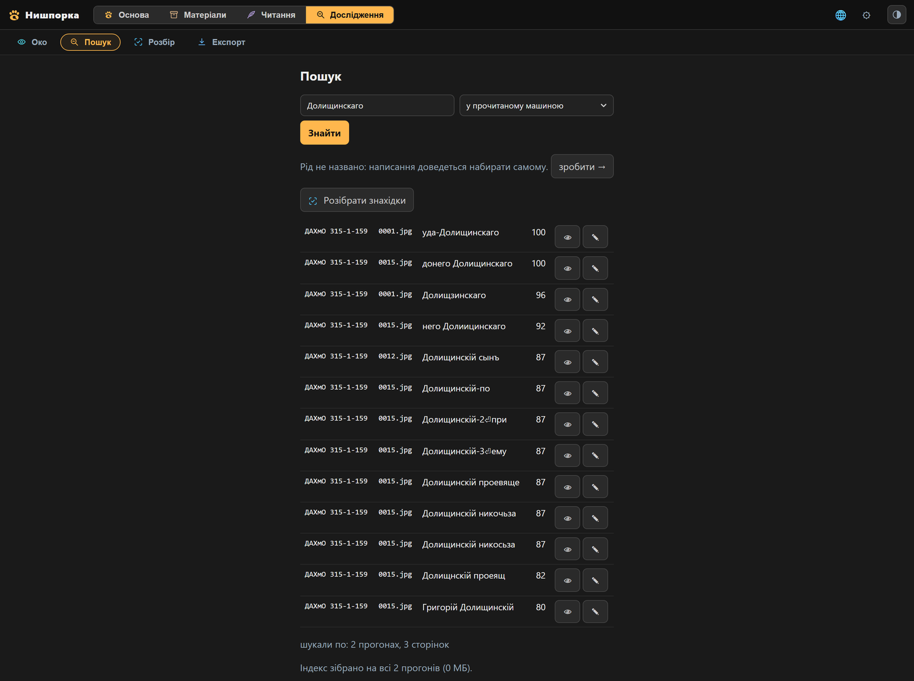

<p align="center">
  
</p>

<p align="center"><em>Читає рукопис. Приносить знайдене.</em></p>

<p align="center">
  <a href="https://pypi.org/project/nyshporka/"></a>
  <a href="https://github.com/SERGIUSH-UA/nyshporka/actions/workflows/ci.yml"></a>
  
  
</p>


**Нишпорка — ШІ-помічник для генеалогів і всіх, хто досліджує минуле за
старими рукописами.** Ви пишете агентові звичайними словами, кого і де
шукаєте: *«ось тека зі сканами метричних книг Чечельника — знайди всіх
Ковальських»*. Агент сам з'ясовує, в яких архівних книгах можуть бути записи
про село, дістає скани, читає старий рукопис власними моделями Нишпорки й
показує рядки з прізвищем просто на сторінці. Ви дивитеся на ці рядки і самі
вирішуєте, чи це ваші предки.

**Що таке агент і що йому дає Нишпорка.** Помічникові на кшталт Claude чи
ChatGPT можна дозволити працювати на вашому комп'ютері: відкривати теки,
запускати програми, записувати результат, щоразу питаючи дозволу. Такого
помічника називають **агентом**. Сам по собі він архівів не знає і старого
рукопису не прочитає. Нишпорка дає йому довідники архівів, описи фондів,
перелік сіл і парафій; власні моделі читання, навчені на українських,
молдовських і польських архівах; пам'ять про вже переглянуте; і правила
чесної роботи: кожну знахідку видно на скані, а «не знайшов» завжди
пояснено, скільки аркушів переглянуто.

**Готових кнопок під кожну задачу тут немає.** З цих інструментів агент
збирає те, що потрібно під конкретне питання, навіть якщо окремої команди для
цього ніхто не робив: *«зроби таблицю всіх шлюбів у цьому селі за 1820-ті»*.
Так проходять весь шлях: від «де шукати» до родоводу, де до кожного факту
прикріплено вирізку зі скану, і до сайту роду з деревом, графом і мапою.
Родовід — звичайні файли на вашому диску, і жодна платформа їх не видалить. А
що розумнішими стають агенти, то більше вміє Нишпорка, навіть без оновлення.

**Не лише предки.** Шукати можна не тільки прізвище, а й назву села, слово чи
подію. Тому за тими самими книгами досліджують історію села й парафії, церкви
чи монастиря, місцевих звичаїв, біографію відомої людини. Скажімо, історію
свого села можна вичитати з гродських книг XVII століття: Нишпорка знайде в
тисячах сторінок кожну згадку села, людей і подій і покаже кожну на скані. Як
це влаштовано — [**від «де шукати» до звіту**](https://nyshporka.online/docs/how-it-works/).

**Що потрібно:** комп'ютер (Windows, macOS або Linux), сама Нишпорка —
безкоштовно, і помічник, що вміє працювати на комп'ютері: **Claude Desktop**
(підписка Claude Pro або Max), **Claude Code** чи **Codex**. Керувати можна й
з телефона — віддалено вести сесію помічника на комп'ютері із застосунку
Claude чи Codex. Скани нікуди не йдуть — усе працює на вашій машині.

<p align="center">
  <a href="https://www.youtube.com/live/VsvenHgbVZY?t=2550"><b>🎥 Подивитися наживо</b></a>
  &nbsp;·&nbsp;
  <a href="https://nyshporka.online/docs/install/"><b>🤖 Поставити й підключити помічника</b></a>
  &nbsp;·&nbsp;
  <a href="https://github.com/SERGIUSH-UA/nyshporka/releases/latest/download/nyshporka-setup.exe">⬇ Завантажити для Windows</a>
  &nbsp;·&nbsp;
  <a href="https://nyshporka.online/docs/start/">як працювати</a>
  &nbsp;·&nbsp;
  <a href="https://nyshporka.online/docs/how-it-works/">як це влаштовано</a>
</p>

> 🎥 **Як це працює, показано наживо** — на стрімі
> [«ШІ-агенти в генеалогії: дослідження майбутнього»](https://www.youtube.com/live/VsvenHgbVZY)
> («В гостях у Качки» №11). Перша частина — про те, навіщо генеалогові агент
> узагалі; [сама Нишпорка в роботі — приблизно з 42-ї
> хвилини](https://www.youtube.com/live/VsvenHgbVZY?t=2550).

## Що дістає агент

* **122 операції з описом і схемою.** `nysh op <ім'я> --describe` віддає
  аргументи й повний докстрінг, нічого не виконуючи; `nysh op <ім'я>` виконує.
  Агентові досить самої команди; MCP-сервер прибрано в 0.19.
* **Скіли — готові процедури під задачу** (`nysh skills list`, ставить
  `nysh skills install` — для Claude Code і Codex): як
  прочитати справу на слабкій машині, як шукати прізвище так, щоб нуль щось
  означав, куди копати далі, як прийняти куплену зйомку, як дотренувати модель
  на своєму почерку.
* **Правила, а не поради** — [`AGENTS.md`](AGENTS.md) і
  [для агентів](https://nyshporka.online/docs/agents/first-session/):
  як читати нуль, чому «не наш рід» вирішує людина, і як агенти вже помилялися
  на цьому матеріалі, з цінами.
* **Одне ядро.** Браузерна консоль і командний рядок — тонкі обгортки
  навколо одного реєстру операцій, тож вони не можуть розійтись у
  відповідях; це перевіряється тестом, а не домовленістю.

Ціна помилки тут інша, ніж у програмуванні, і середовище побудоване саме під
неї: хибне «немає» закриває напрям пошуку назавжди, а хибне «є» йде в родовід і
публікується як факт.

## Що агент зробить вашими сканами

* **Знайде, де лежать документи вашого села** — газетир ЦДІАК (4566 поселень,
  348 408 справ), поаркушевий покажчик плівок, каталог ДАХмО, церкви ~1772.
* **Прочитає рукопис** трьома рушіями: `[П]` **Писар** (кирилиця, головний
  голос), `[Д]` **Дяк** (кирилиця, другий голос — тримається пікселів там, де
  перший додумує), `[С]` **Скриба** (латинка: нотаріат і костельні книги).
* **Покаже, звідки взявся текст** — вирізка рядка з рамкою, сторінка, два
  голоси поруч.
* **Шукатиме прізвище** в прочитаному, у виписаних іменах і в учасниках
  записів.
* **Вестиме облік** переглянутого оком, щоб наступна сесія не гортала ті самі
  аркуші вдруге.
* **Віддасть таблицею** — розібрані акти в Ексель: фільтрувати роками, селом,
  станом і прізвищем.
* **Складе родовід** — картки осіб, родин, місць і джерел, до кожного факту
  вирізка зі скану; дерево з іншої програми засівається з GEDCOM.
* **Збере сайт роду** — сторінки осіб і родин, дерево, граф і мапа місць із
  фільтром за роками; відкрита версія сама прибирає живих.

Докладно, з межами кожного джерела — [**що вже
працює**](https://nyshporka.online/docs/agents/features/).

## Супряга: можливо, справу вже прочитано

Одну й ту саму архівну книгу сьогодні розпізнає кожен окремо, хоча текст
виходить однаковий. [**Супряга**](https://nyshporka.online/supriaha) — спільний
банк прочитаних справ: що прочитав один, інший бере готовим за хвилину замість
годин машинного часу.

* **Їде текст, не зображення.** Справа на кілька тисяч аркушів важить у пакеті
  3–4 мегабайти; скани лишаються в того, хто їх завантажив.
* **Узяти** — `nysh share pull "ДАХмО 315-1-1234" --take`, цілу серію —
  `nysh share pull --repo RGIA --fond 592 --opys 25 --take`. Прийняте одразу
  видно пошуку прізвища.
* **Що є в пулі** — `nysh share pull` без запиту: огляд за архівами, фондами й
  описами.
* **Віддати своє** — `nysh share pack` і `nysh share publish`; ділитися чи ні,
  вирішуєте ви, типово Нишпорка лише нагадує.

Чужий текст читала інша модель, тож «не знайшлось» у ньому важить менше, ніж
у власному прогоні. Докладно — [поділитися
прочитаним](https://nyshporka.online/docs/share/).

## Як це виглядає

Рішення лишається за оком, тож у Нишпорки є й власне обличчя в браузері: там
людина дивиться те, що приніс агент. Без агента воно теж повне — просто всі
кроки доводиться робити руками.

**Видно, звідки взявся текст.** Клацнувши рядок, ви бачите його вирізку з
аркуша — у тому вигляді, у якому його бачив рушій.



**Де взагалі метрики мого села.** Газетир і покажчик плівок їдуть разом із
пакетом і відповідають одразу після встановлення — без сканів, без відеокарти,
без обходу чужих сайтів.



**Видно, скільки перевірено.** Пошук шукає нечітко, бо машина плутає літери
всередині слова. А під знахідками написано, скільки справ і сторінок було
переглянуто — щоб «нічого не знайшлось» не означало «просто ніде не шукали».



## Поставити

🤖 **Ставить агент?** Дайте йому одне посилання — [`AGENTS.md`](https://raw.githubusercontent.com/SERGIUSH-UA/nyshporka/main/AGENTS.md).
Там і встановлення, і перші кроки, і межі, за якими вирішує людина.

👤 **Ставите самі, без термінала?** Покрокова інструкція — три програми в
правильному порядку й один готовий запит —
[**«Поставити й підключити помічника»**](https://nyshporka.online/docs/install/).

**Windows.** [⬇ Завантажити інсталятор][setup] — запустити, відповісти на два
питання, натиснути «Встановити». Python, прав адміністратора й термінала не
треба.

⚠ «Windows захистив ваш ПК» — «Докладніше» → «Виконати в будь-якому разі». Так
Windows зустрічає кожну програму, яку ще мало хто завантажував.

**Термінал, будь-яка система.** На чистій машині, без Python і без прав
адміністратора:

```powershell
irm https://raw.githubusercontent.com/SERGIUSH-UA/nyshporka/main/install/windows.ps1 -OutFile "$env:TEMP\nysh-install.ps1"
powershell -ExecutionPolicy Bypass -File "$env:TEMP\nysh-install.ps1"
```
```sh
curl -LsSf https://raw.githubusercontent.com/SERGIUSH-UA/nyshporka/main/install/unix.sh | sh
```

🔴 Коли скрипт завершить роботу — закрийте вікно термінала й **відкрийте нове**:
доти команда `nysh` у ньому не знайдеться. Якщо й у новому вікні не знаходиться —
**перезапустіть комп'ютер**. (Тим, хто ставив інсталятором, це не потрібно:
ярлики працюють одразу.)

**Docker, без установки в систему.** Готовий образ із рушіями й вагами:
`docker run --rm ghcr.io/sergiush-ua/nyshporka doctor`; для карти NVIDIA — тег
`:cuda` і `--gpus all`. Докладно —
[**«Нишпорка в Docker»**](https://nyshporka.online/docs/docker/).

**Якщо Python або `uv` уже є:**

```bash
uv tool install "nyshporka[app,archives,htr]"   # або: pip install …
nysh init                      # створити робочий простір
nysh doctor                    # перевірити те, що ламається тихо
nysh skills install            # покласти скіли туди, де їх бачить агент
```

🔴 **Щоб читати рукопис — ще два разові кроки.** Самі рушії й навчені моделі в
пакет не входять навмисно: інакше кожен, хто прийшов лише подивитись каталог
справ, платив би за них гігабайтами.

```bash
nysh htr install    # середовище рушіїв: kraken і PARSeq
nysh models get     # ваги трьох моделей, ~225 МБ
```

Під вузьке письмо є [спеціалісти](docs/specialists.md): вони качаються окремо.

Каталогам, газетиру й пошуку по описах вони не потрібні — ті працюють одразу.

На робочій машині розробника інсталятор нічого не переставляє; `--dry-run`
показує, що буде зроблено, а `NYSH_NO_MODIFY_PATH=1` не чіпає PATH зовсім.
Важелі, набори частин, деінсталяція й те, де живе дослідження, —
[**встановлення докладно**](https://nyshporka.online/docs/install/).

## Стан: бета

Від 0.37 Нишпорка в беті: вигляд і порядок роботи більше не змінюються
докорінно, нове виходить великими випусками, виправлення — одразу, окремими
дрібними оновленнями, а дані переходять з версії на версію командою оновлення.

Каталоги, завантаження, читання рукопису, гортач, сховище прочитаного, пошук,
браузерне обличчя й установлення працюють. Скани ви приносите самі; розбір
актів у поля робить ваш агент і вашим коштом — пакет дає нарізку, контракт,
валідацію й чексуми повноти, але сам не читає; а моделі читають добре той почерк, на якому
вчились, — на іншому матеріалі якість не міряна. Повний перелік того, чого ще немає, без замовчувань —
[**межі**](https://nyshporka.online/docs/faq/#chogo-shche-nemaie).

## Далі

| | |
|---|---|
| поставити й підключити помічника, без термінала | [Поставити й підключити помічника](https://nyshporka.online/docs/install/) |
| що просити й як перевіряти знайдене | [Як працювати](https://nyshporka.online/docs/start/) |
| питання першого тижня і чого ще немає | [Часті питання](https://nyshporka.online/docs/faq/) |
| взяти готовий текст справи або віддати свій | [Поділитися прочитаним (Супряга)](https://nyshporka.online/docs/share/) |
| дотренувати модель на своєму почерку | [Дотренувати модель](https://nyshporka.online/docs/train/) |
| прочитати справу на орендованій машині | [Орендована машина](https://nyshporka.online/docs/cloud/) |
| перша сесія агента, приймачі кроків | [Для помічника й розробника](https://nyshporka.online/docs/agents/) |
| що змінилось у версіях | [Що нового](https://nyshporka.online/docs/whats-new/) |

## Приватність, ліцензія, участь

Телеметрії немає, облікових записів немає, дослідження нікуди не
вивантажується, а в мережу застосунок ходить лише тоді, коли його про це
попросили командою — [`PRIVACY.md`](PRIVACY.md).

Код — [AGPL-3.0-or-later](LICENSE). Ваги моделей — окремо
([`LICENSE-MODELS.md`](LICENSE-MODELS.md)): випущені до 0.37.0 — під CC BY-SA 4.0,
нові — під CC BY-NC-SA 4.0 з додатковим дозволом на платні генеалогічні
дослідження, які людина виконує сама; комерційна ліцензія — info@nyshporka.online.
Тексти в Супрязі — під ліцензією, яку обрав вкладник; типова для нових внесків —
CC BY-NC-SA 4.0 (до 0.37.0 була CC0-1.0). Чому саме так, як підписується
інсталятор і що звіряти при завантаженні —
[підписування й ліцензії](https://nyshporka.online/docs/signing/).

Назви «Нишпорка» і «Супряга», логотип і маскот — позначення проєкту; ліцензії
коду й ваг прав на них не дають. Що можна без дозволу і що лише з ним —
[`TRADEMARKS.md`](TRADEMARKS.md).

Знайшли ваду або хочете допомогти — [`CONTRIBUTING.md`](CONTRIBUTING.md) і
[Issues](https://github.com/SERGIUSH-UA/nyshporka/issues).

[setup]: https://github.com/SERGIUSH-UA/nyshporka/releases/latest/download/nyshporka-setup.exe
