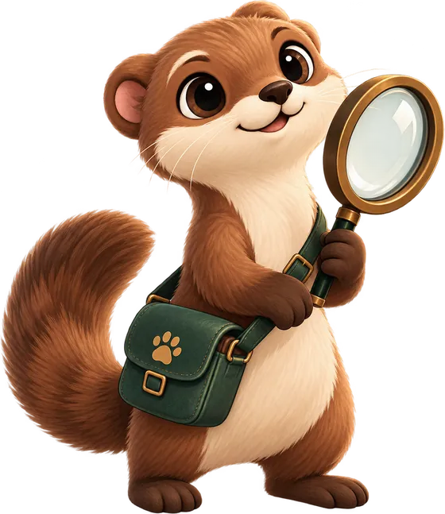

# Nyshporka

{ width="200" height="231" }

<em>Reads the manuscript. Brings back what it finds.</em>

**Nyshporka is an AI assistant for genealogists and anyone researching the
past through old manuscripts.** You say whom and where you are looking for, and
the assistant finds the right archive books, reads the old manuscript and shows
what it found right on the scan.

## The assistant does the work, you decide

{ width="420" height="382" }

An assistant such as Claude or ChatGPT can be allowed to work on your
computer: open folders, run programs, save the results, asking your
permission every time. An assistant like this is called an **agent**.

Nyshporka is made precisely for it. You write in plain words:
*“here is a folder of scans of the Chechelnyk parish registers — find all the Kovalskyis”*.
The agent works out for itself which books may hold records about the village,
fetches the scans, reads the manuscript and shows the lines with the surname
on the page, with the folio number.

You look at these lines and decide for yourself whether they are your
ancestors. In the same way, you decide what to order from the archive and
whether to share what has been read. The assistant shows what it found, and
the conclusions are yours.

!!! tip "Video lessons"

    [A series of short video lessons](https://nyshporka.online/en/uroky) —
    from installation to your first find and a family tree with evidence, 5–9
    minutes each. New lessons keep coming. The lessons are in Ukrainian, with
    subtitles YouTube can translate into your language.

!!! tip "Watch it live"

    Nyshporka is shown at work in the stream
    [“ШІ-агенти в генеалогії: дослідження майбутнього”](https://www.youtube.com/live/VsvenHgbVZY)
    (“AI agents in genealogy: researching the future”, “В гостях у Качки” No. 11) —
    [the demonstration starts at about minute
    42](https://www.youtube.com/live/VsvenHgbVZY?t=2550).

## What Nyshporka gives the assistant

On its own, the assistant knows nothing about archives and cannot read an old
manuscript. Nyshporka gives it:

* **knowledge of where things are** — archive guides, fond inventories, lists of
  villages and parishes;
* **the ability to read manuscripts** — our own reading models trained on
  Ukrainian, Moldovan and Polish archives: **Pysar** and **Diak** read Cyrillic,
  **Skryba** reads Latin script;
* **memory** — what has already been looked through and found, so that the same
  folios are not leafed through twice;
* **rules of honest work** — every find can be seen on the scan, and “not
  found” always comes with an explanation of how many folios were looked
  through.

## There are no ready-made buttons

An ordinary program can do exactly what was built into it: as many buttons, as
many possibilities. Nyshporka gives the assistant separate skills: find a
file, read a folio, find a surname, record a discovery. From them it puts
together what your question needs, even if nobody ever made a separate command
for it: *“make a table of all the marriages in this village in the 1820s”*.
This is how the whole way is covered: from “where to look” to a family tree in
which every fact has a crop of the scan attached, and on to a family website
with a tree and a map. And the cleverer assistants become, the more Nyshporka
can do, even without an update.

## Not only ancestors

You can search not only for a surname but also for the name of a village, a
word or an event. So the same books are used to research the history of a
village or parish, of a church or monastery, of local customs, or the
biography of a well-known person. For example, the history of your own village
can be read out of the 17th-century castle court books: Nyshporka finds every
mention of the village, its people and events among thousands of pages and
shows each one on the scan. More in [not only genealogy](how-it-works.md#ne-lyshe-rodovid).

## What you need

* A computer with Windows, macOS or Linux and about 5 GB of free space.
* Nyshporka itself — free and open source.
* An assistant that can work on a computer: **Claude Desktop** (a Claude Pro
  or Max subscription), **Claude Code** or **Codex** (a ChatGPT subscription).

All of this installs in half an hour, without typing a single command —
[**“Install and connect an assistant”**](install.md). The assistant will install
the reading models itself: these are two one-off steps, `nysh htr install` and
`nysh models get`.

**Your scans go nowhere** — everything runs on your computer. There is no
telemetry and no accounts.

!!! warning "Status: early version"

    The catalogues, manuscript reading, surname search, record-keeping and the
    browser app all work. What is still missing is listed in the
    [frequently asked questions](faq.md#chogo-shche-nemaie), with nothing left unsaid.

## Words you will meet here { #slovnyk }

| word | what it is |
|---|---|
| **assistant (agent)** | an AI assistant — Claude Desktop, Claude Code or Codex — that is allowed to work on your computer |
| **reading models** | Pysar, Diak and Skryba — they turn a handwritten folio into text |
| **read text** | what the model has read from a folio. It contains mistakes: you search in it, and look at what you find on the scan |
| **file** | an archival storage unit with a reference code, e.g. `ДАХмО 315-1-8433`; in Nyshporka, one folder of scans |
| **folio · frame** | a page of the file · a single image (scan) |
| **imaging** | the set of scans of one file — your own, bought, or from an archive's website |
| **working folder** | Nyshporka's folder, by default `Документи\Нишпорка` (Documents\Nyshporka): this is where your research lives. In commands it is called the “workspace” |
| **app** | Nyshporka's window in the browser — for seeing what has been found and leafing through the scans and the read text |
| **skills** | ready-made working routines for the assistant: how to read a file, how to search for a surname, where to dig next |
| **Supriaha** | a shared bank of files already read, at [nyshporka.online/supriaha](https://nyshporka.online/supriaha): what one person has read does not need to be read again |

## Where next

* [How it works](how-it-works.md) — the whole cycle from “where to look” to
  the family site, and how a surname is found in a manuscript (in Ukrainian)
* [Install and connect an assistant](install.md)
* [How to work](start.md) — what to ask for, how to check what has been found
* [Frequently asked questions](faq.md)
* For the assistant and developers — [reference guides](agents/index.md)
