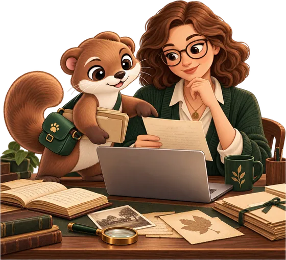

# Нишпорка

{ width="200" height="231" }

<em>Читає рукопис. Приносить знайдене.</em>

**Нишпорка — ШІ-помічник для генеалогів і всіх, хто досліджує минуле за
старими рукописами.** Ви кажете, кого і де шукаєте, а помічник знаходить
потрібні архівні книги, читає старий рукопис і показує знайдене просто на
скані.

## Роботу робить помічник, вирішуєте ви

{ width="420" height="382" }

Помічникові на кшталт Claude чи ChatGPT можна дозволити працювати на вашому
комп'ютері: відкривати теки, запускати програми, записувати результат,
щоразу питаючи вашого дозволу. Такого помічника називають **агентом**.

Нишпорка зроблена саме для нього. Ви пишете звичайними словами:
*«ось тека зі сканами метричних книг Чечельника — знайди всіх Ковальських»*.
Агент сам з'ясовує, в яких книгах можуть бути записи про село, дістає скани,
читає рукопис і показує рядки з прізвищем на сторінці, з номером аркуша.

Ви дивитеся на ці рядки і самі вирішуєте, чи це ваші предки. Так само ви
вирішуєте, що замовити в архіві й чи ділитися прочитаним. Помічник показує
знайдене, а висновки робите ви.

!!! tip "Відеоуроки"

    [Серія коротких відеоуроків](https://nyshporka.online/uroky) — від
    встановлення до першої знахідки й родоводу з доказами, по 5–9 хвилин.
    Серія поповнюється.

!!! tip "Подивитися наживо"

    Нишпорку показано в роботі на стрімі
    [«ШІ-агенти в генеалогії: дослідження майбутнього»](https://www.youtube.com/live/VsvenHgbVZY)
    («В гостях у Качки» №11) — [демонстрація приблизно з 42-ї
    хвилини](https://www.youtube.com/live/VsvenHgbVZY?t=2550).

## Що Нишпорка дає помічникові

Сам по собі помічник архівів не знає і старого рукопису не прочитає.
Нишпорка дає йому:

* **знання, де що лежить** — довідники архівів, описи фондів, перелік сіл і
  парафій;
* **уміння читати рукопис** — власні моделі читання, навчені на українських,
  молдовських і польських архівах: **Писар** і **Дяк** читають кирилицю,
  **Скриба** — латинку;
* **пам'ять** — що вже переглянуто й знайдено, щоб не гортати ті самі аркуші
  вдруге;
* **правила чесної роботи** — кожну знахідку видно на скані, а «не знайшов»
  завжди пояснено, скільки аркушів переглянуто.

## Готових кнопок тут немає

Звичайна програма вміє рівно те, що в неї заклали: скільки кнопок, стільки й
можливостей. Нишпорка дає помічникові окремі вміння: знайти справу, прочитати
аркуш, знайти прізвище, записати знахідку. З них він збирає те, що потрібно
під ваше питання, навіть якщо окремої команди для цього ніхто не робив:
*«зроби таблицю всіх шлюбів у цьому селі за 1820-ті»*. Так проходять весь
шлях: від «де шукати» до родоводу, де до кожного факту прикріплено вирізку
зі скану, і до сайту роду з деревом і мапою. А що розумнішими стають
помічники, то більше вміє Нишпорка, навіть без оновлення.

## Не лише предки

Шукати можна не тільки прізвище, а й назву села, слово чи подію. Тому за
тими самими книгами досліджують історію села й парафії, церкви чи монастиря,
місцевих звичаїв, біографію відомої людини. Скажімо, історію свого села можна
вичитати з гродських книг XVII століття: Нишпорка знайде в тисячах сторінок
кожну згадку села, людей і подій і покаже кожну на скані. Докладніше —
[не лише родовід](how-it-works.md#ne-lyshe-rodovid).

## Що потрібно

* Комп'ютер із Windows, macOS або Linux і близько 5 ГБ вільного місця.
* Сама Нишпорка — безкоштовно, з відкритим кодом.
* Помічник, що вміє працювати на комп'ютері: **Claude Desktop** (підписка
  Claude Pro або Max), **Claude Code** чи **Codex** (підписка ChatGPT).

Усе це ставиться за пів години, без жодної команди —
[**«Поставити й підключити помічника»**](install.md). Моделі читання помічник
поставить сам: це два разові кроки, `nysh htr install` і `nysh models get`.

**Скани нікуди не йдуть** — усе працює на вашому комп'ютері. Телеметрії й
облікових записів немає.

!!! warning "Стан: рання версія"

    Каталоги, читання рукопису, пошук прізвища, облік і застосунок у браузері
    працюють. Чого ще немає — у [частих питаннях](faq.md#chogo-shche-nemaie),
    без замовчувань.

## Слова, які тут трапляються { #slovnyk }

| слово | що це |
|---|---|
| **помічник (агент)** | ШІ-помічник — Claude Desktop, Claude Code або Codex, — якому дозволено працювати на вашому комп'ютері |
| **моделі читання** | Писар, Дяк і Скриба — вони перетворюють рукописний аркуш на текст |
| **прочитаний текст** | те, що модель прочитала з аркуша. Він з помилками: у ньому шукають, а знайдене дивляться на скані |
| **справа** | архівна одиниця зберігання з шифрою, напр. `ДАХмО 315-1-8433`; у Нишпорці — одна тека зі сканами |
| **аркуш · кадр** | сторінка справи · одне зображення (скан) |
| **зйомка** | набір сканів однієї справи — ваш власний, куплений чи з архівного сайту |
| **робоча тека** | тека Нишпорки, типово `Документи\Нишпорка`: там лежить ваше дослідження. У командах вона зветься «простір» |
| **застосунок** | вікно Нишпорки в браузері — щоб бачити знайдене, гортати скани й прочитане |
| **скіли** | готові порядки роботи для помічника: як прочитати справу, як шукати прізвище, куди копати далі |
| **Супряга** | спільний банк прочитаних справ на [nyshporka.online/supriaha](https://nyshporka.online/supriaha): прочитане одним не треба читати вдруге |

## Куди далі

* [Як це влаштовано](how-it-works.md) — весь цикл від «де шукати» до сайту
  роду і як знаходиться прізвище в рукописі
* [Поставити й підключити помічника](install.md)
* [Як працювати](start.md) — що просити, як перевіряти знайдене
* [Часті питання](faq.md)
* Для помічника й розробника — [довідники](agents/index.md)
